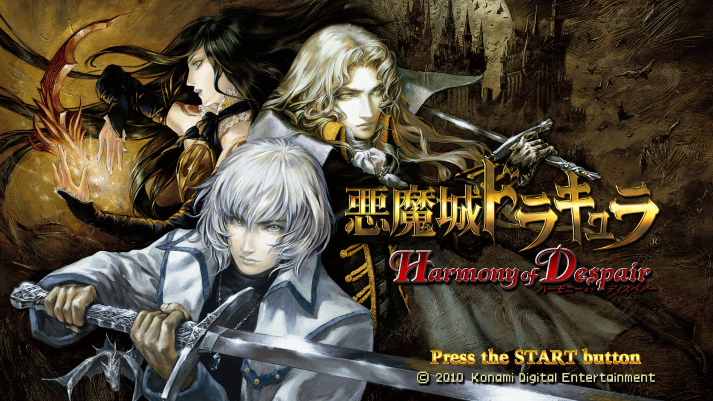
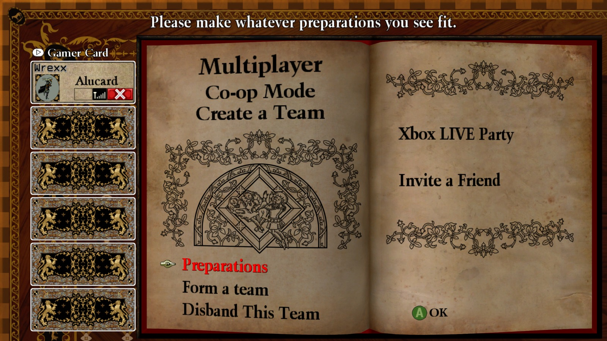
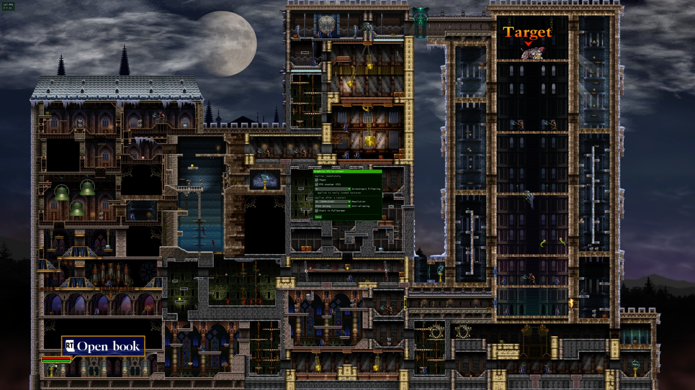
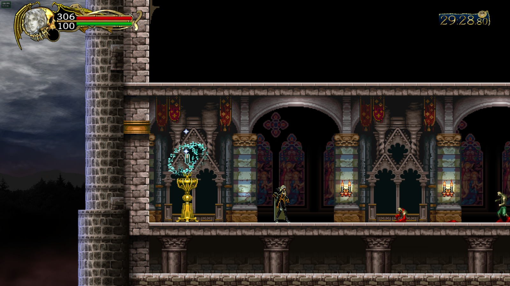

# HarmonyRecomp

A static recompilation of **Castlevania: Harmony of Despair** (Xbox Live Arcade, title ID `58410A7A`) for Windows, built on the [ReXGlue SDK](https://github.com/birabittoh/rexglue-sdk) and modelled on [NocturneRecomp](https://github.com/birabittoh/NocturneRecomp).

The PowerPC code of `default.xex` and the character modules is translated to C++ at build time and compiled natively for x86-64. Graphics, audio and the Xbox system services come from the ReXGlue runtime (derived from [Xenia](https://github.com/xenia-project/xenia)).

> **This repository contains no game code or data.** You need your own copy of the game, dumped from your own console or purchase. Never share `game/`, `assets/`, `dlc/` or `generated/`: they contain the game or code derived from it.

## Screenshots

| Title screen | Online lobby |
| --- | --- |
|  |  |

| In-game with graphics menu | Gameplay with FPS counter |
| --- | --- |
|  |  |

## Features

- Runs the full game natively on Windows: all stages, all six base characters
- Graphics menu (F6): resolution scale, anti-aliasing, anisotropic filtering, VSync, fullscreen
- FPS counter (F2)
- **Online co-op without Xbox Live**: up to six players over LAN or a virtual LAN (Radmin VPN, ZeroTier, Tailscale)
- **DLC support**: put your own DLC packages into `dlc/` (see below)
- Crash reports in `logs/` to make bug reports useful

## Requirements

- Windows 10/11, x86-64
- Your own XBLA package of the game (the file without extension in `58410A7A/000D0000/`, it starts with `LIVE`)
- About 15 GB of free space (build tools, SDK and build)

## Easiest way: the launcher

`HarmonyLauncher.exe` does everything below with buttons: choose your game file (and DLC), press **BUILD**, then **PLAY**.

- It checks that the file really is Harmony of Despair (title ID `58410A7A`) before building.
- On the first build it downloads about 850 MB of portable build tools into folders next to itself (see [Portable build tools](#portable-build-tools)). **Nothing is installed on your system** and no administrator rights or Visual Studio are needed. With the prebuilt SDK from `HarmonyLauncher.zip` the first build takes a few minutes after the download (20 to 40 if the SDK has to be compiled); later builds only redo what changed.
- The **Settings** tab edits `harmonyrecomp.toml`: fullscreen, full game / trial, and online co-op (name, peers).
- The full build output is in `launcher.log` next to the launcher and on the **Build log** tab.

Put the launcher in an empty folder of its own (not `Program Files`), e.g. `C:\Games\HarmonyRecomp\`. Placed inside a clone of this repository it builds that clone instead.

To build the launcher yourself (needs the .NET 10 SDK):

```powershell
dotnet publish launcher -c Release
# -> launcher\bin\Release\net10.0\win-x64\publish\HarmonyLauncher.exe (single file, no .NET needed to run it)
```

To make the zip players download (launcher + this repository + a **prebuilt SDK**, so their first build skips the SDK and takes minutes instead of half an hour):

```powershell
python scripts\build.py --toolchain portable    # once: builds the SDK with the portable tools
python scripts\make_launcher_package.py         # -> ..\HarmonyLauncher.zip (about 60 MB)
```

The package holds no game files and no code derived from the game. `build.py` uses the bundled SDK only while it matches `sdk-pin.txt`, the SDK patches and the toolchain; otherwise it clones and builds the SDK as usual.

## Portable build tools

`scripts\toolchain.py` downloads everything the build needs into `..\harmonyrecomp-tools\`, next to this folder:

```powershell
python scripts\toolchain.py fetch
```

LLVM/Clang 20, CMake, Ninja, MinGit and 7-Zip come from their official GitHub releases. The Microsoft C/C++ runtime headers and libraries (three `.vsix` packages from Microsoft's Visual Studio CDN) and the Windows SDK (two packages from nuget.org) are downloaded from Microsoft on your own PC; this repository never redistributes them. Every file is pinned with its size and SHA-256/SHA-512 in `toolchain.lock.json` and checked before it is unpacked. Once fetched, `build.py` uses these tools automatically (`--toolchain portable` / `--toolchain system` to choose).

Alternatively install the tools system-wide, e.g. with [Scoop](https://scoop.sh), plus Visual Studio Build Tools with the C++ workload:

```powershell
scoop install llvm cmake ninja git python
```

The SDK needs **Clang 20 or newer** (`clang++ --version`).

## Building

1. Clone this repository.
2. Copy your game package into `game\` (exactly one file).
3. Optional: copy your DLC packages into `dlc\` (see [DLC](#dlc)).
4. Build:

   ```powershell
   python scripts\build.py
   ```

`build.py` runs every step in order and skips what is already done:

1. Extract the game package into `assets\` (and DLC packages into `assets\dlc\`)
2. Clone the ReXGlue SDK at the commit in `sdk-pin.txt` into `..\rexglue-sdk\`, **next to** this folder, and apply the local SDK patches (`SDK_PATCHES` in the script)
3. Build and install the SDK, including the `rexglue` codegen tool (takes the longest)
4. Run codegen (about 2 minutes), output in `generated\`
5. Build the game into `out\build\win-amd64-release\`

Options: `--debug`, `--codegen-only`, `--force-codegen`, `--toolchain auto|portable|system`. Codegen reruns automatically when the manifest, a `harmonyrecomp_*.toml`, the DLC set or the SDK patches change.

## Running

```powershell
cd out\build\win-amd64-release
.\harmonyrecomp.exe
```

The executable finds the game data by itself: `--game_data_root`, then `game_data_root` in `harmonyrecomp.toml`, otherwise `assets` next to the exe or in the project folder.

Settings live in `harmonyrecomp.toml` next to the exe (copied there on the first build, your edits are kept). `license_mask = 1` reports the full game; without it the game runs as the trial version. The license of your purchase stays on your Xbox account and cannot be read by the recompiled game.

| Key | Function |
| --- | --- |
| F2 | FPS counter |
| F3 | SDK debug overlay (frame times) |
| F4 | All SDK runtime settings |
| F6 | Graphics menu ("Save" writes `harmonyrecomp.toml`) |
| `^` | Log console |

Logs are written to `logs\` next to the exe. If the game crashes, a `crash_*.txt` appears there as well; please attach it (and the matching log) to bug reports. The build also writes `harmonyrecomp.map`, which turns the addresses in a crash report into function names.

## Online co-op

On the Xbox 360 the game's co-op (up to six players) only works over Xbox Live. HarmonyRecomp replaces the required services in `src/netplay/`:

- **Sign-in:** the game sees a player signed in to Live with their own gamertag and online XUID. The offline profile, and with it your save data, stays unchanged.
- **Sessions and matchmaking:** create, search, join, details, host migration. Instead of a server, the search asks all PCs in the network (broadcast) plus the addresses in `netplay_peers`. Every player runs a small lobby service on UDP port `47658`.
- **XNet and QoS:** players are identified by their IPv4 address. The game's own traffic is plain UDP on port `1000` directly between the PCs.

### Playing with friends over the internet

1. **Set up a virtual LAN.** Everybody joins the same network:
   - **Radmin VPN** or **ZeroTier**: lobbies are found automatically.
   - **Tailscale**: does not forward broadcasts; put each other's Tailscale IP into `netplay_peers`.
2. **Everybody builds the project** with their own copy of the game. All players should use the same version of this repository.
3. **Settings** in `harmonyrecomp.toml` next to the exe:

   ```toml
   netplay_enabled = true
   netplay_name = "YourName"     # different for every player, max. 15 characters
   # netplay_peers = "100.x.y.z" # only needed if the search finds nothing
   ```

4. **Firewall:** on the first start Windows asks for network access. Allow `harmonyrecomp.exe` on **private and public** networks; VPN adapters are often classified as public. The ports are UDP `47658` (lobby) and UDP `1000` (game).
5. One player creates a room in the online menu, the others search and join.

The log shows every step with `[netplay]`: the chosen address, lobbies found, QoS results, opened ports.

| Setting | Meaning |
| --- | --- |
| `netplay_enabled` | Online co-op on/off (default: off) |
| `netplay_name` | Gamertag shown to other players |
| `netplay_ip` | Force your own address, e.g. the VPN IP (default: automatic, VPN adapters preferred) |
| `netplay_peers` | Additional players for the search: `ip` or `ip:port`, comma separated |
| `netplay_port` | UDP port of your lobby service (default 47658) |
| `netplay_remote_port` | Lobby port of the others (only for two instances on one PC) |
| `netplay_search_ms` | How long the lobby search waits (default 1000 ms) |

## DLC

The game's downloadable characters and chapters are content packages (the files in `58410A7A/00000002/` on your console). Use your own:

1. Copy the package files into `dlc\` in the project folder.
2. Run `python scripts\build.py`. It unpacks them into `assets\dlc\`, finds the character modules (`dll*.dll`) in them and recompiles them like the base characters.
3. Start the game. On the first start the packages are installed into the runtime's content folder (this takes a moment); the log shows `[dlc] installed …`.

DLC support has been tested with the build and installation pipeline, but not yet with real DLC packages. If a DLC character crashes with "unregistered function", the module needs a small config file like `harmonyrecomp_dllsoma.toml`; please open an issue with the log and crash report.

## Project layout

| Path | Content |
| --- | --- |
| `harmonyrecomp_manifest.toml` | Codegen entry: `default.xex` and the six character modules |
| `harmonyrecomp_config.toml` | Game-specific codegen settings (functions, CRT addresses, jump tables) |
| `harmonyrecomp_dll*.toml` | Codegen settings per character module |
| `harmonyrecomp.toml` | Template for the runtime settings |
| `src/` | Host code: app, graphics menu, crash reports, runtime fixes, DLC installation |
| `src/netplay/` | Online co-op: Live replacement, sessions, lobby service, game sockets |
| `scripts/build.py` | Complete build, including the SDK patches |
| `scripts/toolchain.py`, `toolchain.lock.json` | Portable build tools (no Visual Studio), pinned by checksum |
| `launcher/` | `HarmonyLauncher.exe` (C#, Avalonia): choose game/DLC, build, settings, play |
| `scripts/extract_game.py` | STFS package extractor (game and DLC) |
| `sdk-pin.txt` | SDK commit the project is tested with |

## Technical notes

- `default.xex`: original name `dcHD_Master.exe`, version `0x00000104`, base `0x82000000`, size `0x960000`, entry `0x8263BA90`, XDK 2.0.9328.0.
- Character modules are XEX DLLs in `data\player_dll\` with fixed load addresses (Alucard `0x83000000`, Soma `0x83090000`, Jonathan `0x83120000`, Charlotte `0x831B0000`, Shanoa `0x83240000`, Axe Armor `0x83510000`).
- Every recompiled module has an indirect-call table in guest memory, normally right behind its image. The main table (~13 MB) would cover the character load addresses, so it lives at `0x8C000000`; character modules get 1 MB slots from `0x8D000000` (DLC characters follow the base ones). This needs the relocatable-table patches in `build.py`.
- `sub_8277ECF0` uses a byte jump table without bounds check; its 16 real entries are listed in `harmonyrecomp_config.toml`.
- SDK patches in `build.py` (applied automatically): switch tables in the function scanner, relocatable function tables, readable message box text, settings file escaping, and stale handles cached in guest dispatcher headers (a crash source in online sessions).
- The netplay layer keeps the game's sockets in its own handle table and implements overlapped `WSARecvFrom`/`WSASendTo`/`WSAGetOverlappedResult`, which the SDK only stubs.

## Known issues

- Closing the game sometimes ends with a crash report (heap corruption during runtime shutdown). The game has saved by then; it does not affect playing.
- DLC support is untested with real packages (see above).

## Credits

- [ReXGlue SDK](https://github.com/birabittoh/rexglue-sdk) and [Xenia](https://github.com/xenia-project/xenia): recompiler and runtime
- [NocturneRecomp](https://github.com/birabittoh/NocturneRecomp): project structure and the original STFS extractor
- Xbox 360 structure layouts as documented by the Xenia project

## License

The code in this repository is licensed under the BSD 3-Clause License, see [LICENSE](LICENSE). `scripts/extract_game.py` is based on MIT-licensed code, see `scripts/LICENSE-NocturneRecomp.txt`.

Castlevania and Harmony of Despair are trademarks of Konami Digital Entertainment. This project is not affiliated with or endorsed by Konami or Microsoft.
